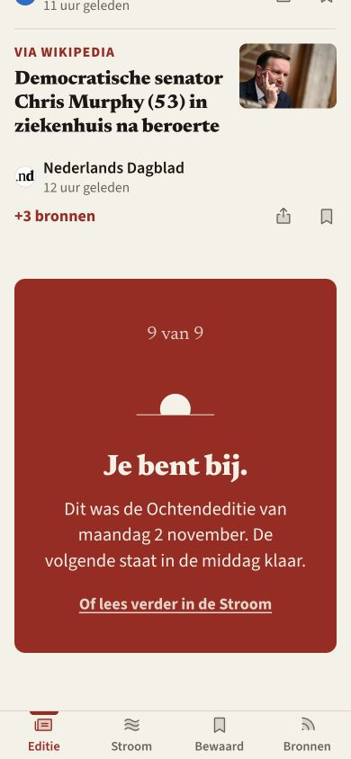
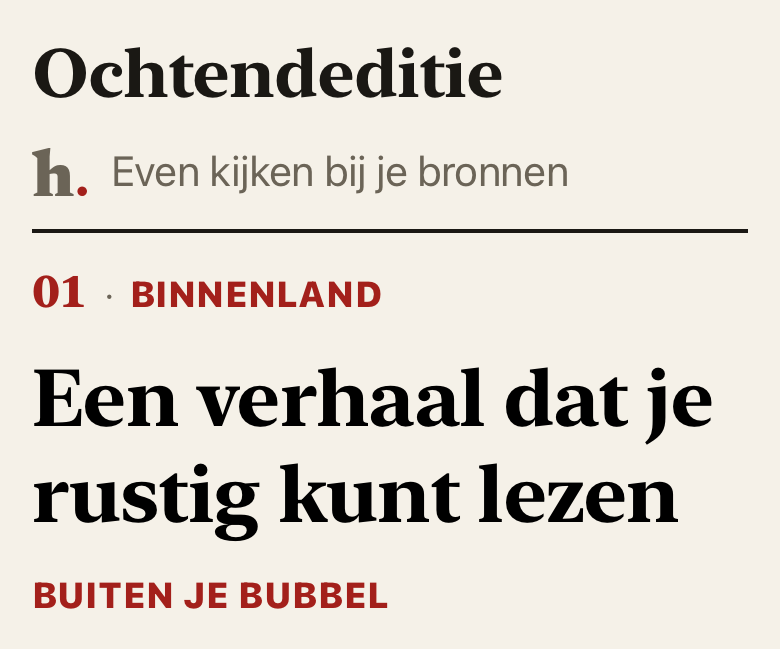

# Editie-nummering · blok 14

2 november 2026 · branch `editie-nummering` · basis main `e262b51`.

## Gebouwd

De zichtbare webrijen krijgen hun al berekende nummer door: hoofdverhaal 01, daarna de getoonde volgorde. Ook een ingeklapte plek houdt zijn nummer. ‘Buiten je bubbel’ krijgt geen nummer en telt niet mee. Native spiegelt dit met `EditionNumbering`, na de bestaande keuze van het hoofdverhaal. De rode eindkaart toont het werkelijke aantal: bijvoorbeeld ‘9 van 9’.

Web gebruikt Newsreader 800 in rood. Omdat deze fontbestanden geen tabelcijfers bevatten, krijgt ieder cijfer een even breed vak; `font-variant-numeric` blijft ook ingesteld. Breed web reserveert ruimte binnen de kaartmarge. Native gebruikt conform T3 de systeemserif met monospacedDigit en op breedte een nummerplaats van minimaal 24 pt. Gelezen nummers en rubrieken worden native ink3, zoals de kop; labeltekst en waarom blijven inhoudelijk gelijk.

De iOS-verversmarkering staat voor de Editie in de normale documentstroom **onder de titel**. De algemene refreshmodifier behoudt zijn bestaande overlay voor andere schermen. In de Editie rapporteert hij alleen zijn wachttoestand. De begintoestand zonder verhalen blijft een eigen laadvlak onder de titel. Er zijn geen nieuwe bewegingen toegevoegd.

## Bewijs en tests

- `npm test`: **892 tests, 891 geslaagd, 0 fouten, 1 bestaande TODO**. [Log](editie-nummering/tests-web.log).
- `npm run build`: geslaagd. [Log](editie-nummering/build-web.log).
- Native: **55 tests, 0 fouten** op iPhone 17 Pro iOS 26.0. Twee nieuwe tests dekken de getoonde volgorde, bubbel, breed, leeg, korte/volle Editie en renderen kop, wachtmarkering en nummer bij normaal en XXXL. [Log](editie-nummering/tests-ios.log).
- Web interactief gecontroleerd op 390 en 1280 px. DOM gaf 01–09, zonder bubbelnummer, en ‘9 van 9’. Bij de eigen grote webtekst (19,2 px root) geen horizontale overflow op 390 px. Web heeft geen instelling met de naam XXXL; die term hoort hier bij de native controle.
- De bestaande bronteksttest is aangepast aan de nieuwe nummercomponent en controleert nu ook de daadwerkelijke doorgifte naar alle drie webrijvormen. De gedragsproeven voor `numberRows` blijven ongewijzigd groen.

Native componentrender, XXXL (geen volledige appscreenshot):

## Nog te keuren

De volledige native klik-/trekproef blijft **open**. Device Hub geeft via de bediening geen scherm terug. De componentrenders tonen de bedoelde scheiding, maar bewijzen niet het scrollgedrag bij trekken, terugkeren of een nieuw venster. Laat Claude vóór samenvoegen eenmaal verversen bij normaal, XXXL en AX5 en de eindkaart bekijken. Er is geen releasevrijgave.

Geen wijziging aan de Redacteur-kern, labels/waaromregels, HootStore.swift of landing. Er is niet gepusht, samengevoegd of gepubliceerd. Bij combinatie met `lezer-wachttekst` raakt ook die branch QuietMotion.swift: behoud zowel de passende lezertekst als de optionele refreshindicator en callback. De Stroom-overlay is bewust buiten dit blok gehouden.
