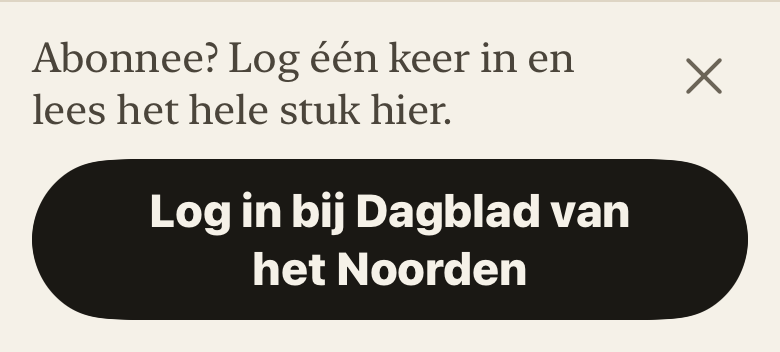
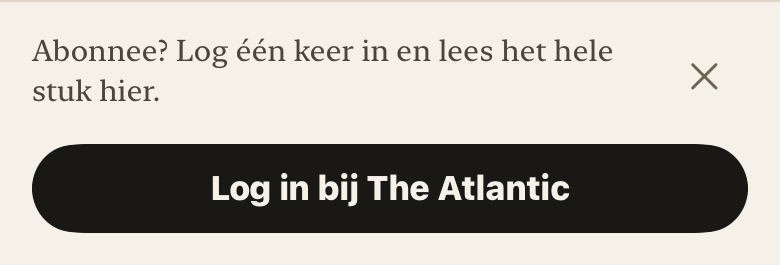
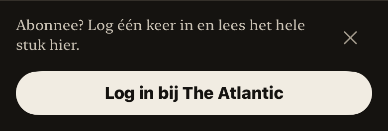

# Inlogpaneel · blok 13

**Scope: Branch, nog niet geïntegreerd.** Gebouwd na de verduidelijkingen van Alex; geen claim dat Main al gewijzigd is.

2 november 2026 · `lezer-inlog-paneel`, basis **lezer-wachttekst 7552530**, zoals opgedragen.

## Gebouwd

Het paneel onder een kort artikel van een betaalde bron gebruikt één korte serifzin en één pilknop ‘Log in bij …’. De tweede knop ‘Bij de uitgever’ is uit dit paneel verdwenen; de bestaande uitgeversknop in de werkbalk en inloggen via Instellingen blijven bestaan. Er is niet ingelogd en geen wachtwoord gebruikt.

Sluiten heeft een aanraakvlak van 44 pt en een VoiceOver-label. Neerwaarts wegvegen en de toegankelijkheidsactie Sluiten doen hetzelfde. De safe-area-inset verdwijnt; er is geen blijvende offset of extra artikelpadding toegevoegd. De bestaande HTML-weergave herlaadt niet als alleen de paneelruimte verandert.

## De vastgelegde keuzes

- Tot en met XXXL blijft de volledige tekst op één regel als hij past. `ViewThatFits` meet de **werkelijke tekst, lettermaat en beschikbare ruimte**. Past dat niet, dan loopt de knop door. Geen namenlijst, geen kleinere letters en geen ellips. Vanaf AX1 is doorlopen altijd toegestaan. Dit volgt de laatste bevestiging van Alex en vervangt de eerdere absolute één-regelregel.
- Na sluiten blijft het paneel zeven etmalen weg, lokaal per stabiele bron-id. Daarna mag het **nog één keer** verschijnen. Die herinnering wordt bij aanbieden vastgelegd, ook als je daarna de lezer zelf sluit. Vervolgens blijft hij weg; Instellingen blijft beschikbaar.
- Een MainActor-store leest vóór iedere claim de laatste UserDefaults-waarde. Twee leesvensters kunnen zo niet elk dezelfde herinnering verbruiken. Geen nieuwe accountvelden, sync of backend nodig.

## Testen

- `npm test`: **894 tests, 893 geslaagd, 0 fouten, 1 bestaande TODO**. Dit omvat ook de meegeleverde tests van de basisbranch lezer-wachttekst. [Log](lezer-inlog-paneel/tests-web.log).
- `npm run build`: groen. [Log](lezer-inlog-paneel/build-web.log).
- Native volledige suite op iPhone 17 Pro iOS 26.0: **63 tests, 0 fouten**. [Log](lezer-inlog-paneel/tests-ios.log).
- Gedrag: direct na sluiten, één seconde vóór zeven dagen, precies op de grens, maar één herinnering, blijvend verborgen daarna, opslag/herstart, verschillende bronnen, teruggezette klok, ongeldige opslag en twee afzonderlijke stores voor twee vensters.
- Layout: werkelijk paneel gerenderd op normaal, XXXL, donker, AX1 en aanvullend AX5. Een nieuwe, onbekende lange bronnaam geeft meer hoogte zonder een hardcoded namenlijst. Breedtemeting bevestigt dat The Atlantic past, maar ‘Dagblad van het Noorden’ op 390 pt bij XXXL 383 pt nodig heeft waar 310 pt beschikbaar is.

## Controlebeeld voor Alex

**390 pt breed, XXXL**, render op 2×. Volledige naam op twee regels, dezelfde buitenmarges en pilvorm:

Normaal:

Donker:

Aanvullend is ook AX5 gecontroleerd met de lange naam: **390 × 550 pt**, dus onder dezelfde bovengrens van 600 pt als de andere paneelproeven. De gerichte layouttest slaagt; productiecode is na de gezamenlijke proef niet gewijzigd. [Extra AX5-log](lezer-inlog-paneel/extra-layouts-ax5.log).

Dit zijn native componentrenders, geen volledige artikel-schermopnamen. De volledige klik-/swipeproef in de echte lezer staat nog open: Device Hub werkt kort, maar valt opnieuw uit met ScreenCaptureKit -3812. De broninlog en het blijvende herstel van de leesruimte moeten vóór release nog eenmaal interactief worden gekeurd. De zeven-dagenregels zijn wel automatisch getoetst; die hoeven niet met een systeemklokverzet te worden nagebootst.

## Samenvoegen

De branch bevat de eerdere passende lezer-laadtekst. Gebruik óf het volledige pakket vanaf main (`lezer-inlog-paneel.patch.gz`), óf de delta vanaf 7552530 na integratie van lezer-wachttekst (`lezer-inlog-paneel-delta.patch.gz`); niet beide. De oude conceptpatch is vervallen en verwijderd. Bij combinatie met blok 14 in QuietMotion.swift zowel de passende WaitingMark-tekst als de nieuwe refreshindicator/callback behouden. Geen kernbestanden of landing gewijzigd, niet gepusht of gepubliceerd.

## Gezamenlijke controle met de nieuwe Main

Main 0a209da + broncode van blok 14 + het complete blok 13 zijn in een schone tijdelijke kopie samen getest: **908 webtests geslaagd, 1 bestaande TODO, build groen, 65 native tests geslaagd**. De zeven beschermde kernbestanden blijven bytegelijk aan Main. Niets samengevoegd in de echte repository. Zie `Hoot-design/CODEX-BLOKKEN-INTEGRATIE-2026-11-02.md` voor logs, hashes en de testkopie. Dit vervangt de open interactieve native proeven niet.
