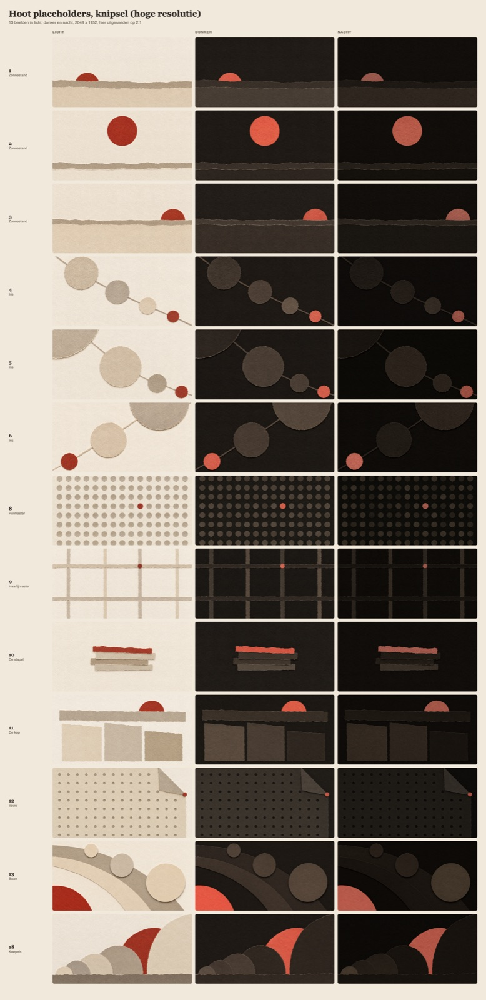

# Hoot · Brand guide v2.5

Zondag 15 november 2026, voor iOS 1.4 en de website. Vervangt v2.4 en gaat erboven waar ze verschillen; v2.4, v2.3 en v2.2 blijven als [`brand-guide-v2.4.md`](brand-guide-v2.4.md), [`brand-guide-v2.3.md`](brand-guide-v2.3.md) en [`brand-guide-v2.2.md`](brand-guide-v2.2.md) staan. Register: `tokens.json` (versie 3). Code: web `src/styles.css`, `src/styles/kaart.css` en `src/styles/bluesky.css`, iOS `ios/Hoot/Views/Letters.swift`, `Components.swift` (`Theme`), `Layout.swift`, `ios/Hoot/Theme/NachtThema.swift` en `Assets.xcassets`. Bij twijfel is de code leidend.

Nieuw in v2.5 is alleen de placeholder: het beeld dat een artikel krijgt als het geen bruikbare foto heeft. Bronnen: de keuzes van Alex van 14 en 15 november (Eclips en Walsen eruit; "16, 17 en 07 halen we helemaal uit het product. Rest zetten we high-res door in Luma en plaatsen we als placeholder bij artikelen."), de goedgekeurde proeven in `Hoot-design/merk/placeholders-luma-2026-11-15/` en de beelden in hoge resolutie in `hires/` daarin. De rest komt ongewijzigd uit v2.4. De PDF in de merkmap ("079 - Hoot - Brand Guide v2.5.pdf") volgt deze gids.

Inhoud: [0 Wat is nieuw](#0--wat-is-nieuw-in-v25) · [1 Keuzes](#1--keuzes-voor-110-en-111) · [2 Kleur](#2--kleur) · [3 Type](#3--type) · [4 Ruimte en maten](#4--ruimte-en-maten) · [4b Kaart A+ en de Bluesky-kaart](#kaart-a-plus) · [5 Beweging](#5--beweging) · [6 Merk](#6--merk-app-icoon-deelkaart-bronmerk) · [6b Beeldtaal](#beeldtaal) · [6c Beelden en placeholders](#beelden) · [7 Onderdelen](#7--onderdelen) · [8 Normaanpassingen](#8--normaanpassingen-uit-de-ds-toets) · [10 Stem en toon](#stem-en-toon) · [11 Register en code](#register-en-code)

---

## 0 · Wat is nieuw in v2.5

| Hoofdstuk | Verandering |
|---|---|
| Beelden | **De placeholder is een knipsel**: een collage van matte papiersoorten, met de schaar geknipt, vlak van boven gefotografeerd, met één rood vlak. Gemaakt met Luma op de composities van de oude vlakke beelden (§6c). |
| Beelden | **Dertien beelden**: Zonnestand 1, 2, 3 · Iris 4, 5, 6 · Puntraster 8 · Haarlijnraster 9 · De stapel 10 · De kop 11 · Vouw 12 · Baan 13 · Koepels 18. De nummers blijven wat ze waren. |
| Beelden | **Uit het product**: 7 Horizonlijnen, 14 Eclips, 15 Walsen, 16 Zetsel en 17 De rij. |
| Kleur | **Papierpalet per thema** voor de knipsels: Licht, Donker en Nacht, elk met precies één rood (§6c). |
| Beeldtaal | Het verbod op schaduw en textuur geldt voor de beeldtaal. **De placeholder is de uitzondering**: papier, vezel en een heel zachte schaduw horen bij het knipsel (§6b). |

Wat in v2.4 nieuw was (Rubrica, Voor jou, de Bluesky-kaart A+, de woordenlijst, de punt in inkt op rood), geldt ongewijzigd; zie [`brand-guide-v2.4.md` §0](brand-guide-v2.4.md#0--wat-is-nieuw-in-v24).

---|---|
| Kleur | **Merkrood Rubrica** (PMS 484 C), scherm `#9A3324`, voor `accent` en `brand-red` (was `#A3201B`); `accent-soft` `#F2E4DF`. Donker `#EC7A70` en Nacht `#DF8276` blijven; de eindkaart in Nacht is `#41150F`. Overal in de merkmap doorgevoerd: logo's, app-icoon (bron en web), kleurstaal, beeldtaal, social, opstartscherm en de beelden in de gids. Nog met de waaier: CMYK uit Pantone Color Bridge en HKS K/N (§2). |
| Beelden | **Tien placeholders** in vijf sets: Zonnestand 1–3 (beeld 3 nu een vol rood vlak), Iris 4–6, Horizonlijnen 7, Raster 8–9, De stapel 10 (§6c). |
| Editie | **Geen "Jouw Editie" meer onder de titel**: alleen de datum, en alleen wat afwijkt erachter ("Om te beginnen", "De Editie voor iedereen"). Web en app gelijk. |
| Welkom | **Voor jou**: het voorstel in de bronnenstap, opgebouwd uit je interesses (drie tot vijf bronnen). Alleen gratis bronnen staan alvast aan; een betaalde staat erbij met "Abonnement", uit. "Later kiezen" is weg; de regel "Alvast gevolgd." staat direct onder de kop. Categorieën zijn in te klappen (§7). |
| Stroom | **Bluesky-kaart A+**: een Bluesky-bericht op het ritme van kaart A+, met een stille rubriek "Bluesky" en de tekst schreefloos (§4b). |
| Stem en toon | **Eén woordenlijst** op web, app en landing: Vergelijken, Instellingen, Account, "Hoot kiest elke Editie", drie keer per dag tien verhalen, elke maandag de Selectie (§10). |
| Landing | **Op rood staat de punt achter een kop in inkt**, nooit rood op rood (§6). |

Wat in v2.3 nieuw was (twee families, kaart A+, witte randen, De stapel, Tien, de leesstijl), geldt ongewijzigd; zie [`brand-guide-v2.3.md` §0](brand-guide-v2.3.md#0--wat-is-nieuw-in-v23).

---

## 1 · Keuzes voor 1.1.0 en 1.1.1

Door Alex gemaakt op 4 en 5 november; norm vanaf v2.2. Nieuw in v2.3, v2.4 en v2.5 staat onderaan de tabel.

| Onderwerp | Keuze |
|---|---|
| Onboarding | Mix: uitleg van A (met de juiste animatie: de zon achter de horizon), bronnen van B. Eerst interesses, dan bronnen. Interesses en Selectie op één scherm. Een seintje na de eerste Editie. Terughoudend vragen om een account. |
| Bovenbalk | A: kopregel met een vlakke strook. |
| Iris | Eerst vervagen, dan reizen. |
| Minder rood | B, met de segmenten van A: rubriek grijs, nummer in inkt. |
| Breed | B op iPad staand, A breed. |
| Stroom-tabs | A: schuiven, met een zachte rand. |
| Eindzin | Vast per Editie: web en iOS tonen bij dezelfde Editie dezelfde zin. "Dan ben je bij." blijft op de landing en in de onboarding. |
| Selectie en lezen | "Hoe kiest Hoot" 1 · Kort · Selectie-index B (inhoud bovenaan) · inlogpaneel A (paneel onderaan) · Instellingen A met de samenvatting uit B. |
| Labels | Eerste themakeuze heet **Zoals je toestel** (Instellingen D, 5 november; eerder Automatisch, nooit "Systeem"). Melding: "Hoot uit je Apple ID halen lukte niet". |
| Beeldtaal | Composities 01, 02, 04, 05, 06, 07, 09, 10 en 11. Lijntekening in lege schermen: ja. |
| Kleurverhouding | 60 · 30 · 10. |
| App-icoon | "Icoon moet te kiezen zijn. Rood behouden." Rood standaard, de keuze blijft. |
| Pull-strook | Horizon v2, strook 400 ms. |
| Leesbreedte | Web 720, iOS 680. |
| Deelkaart | Papieren schijf achter het uitgeverslogo: ja. |
| **Letters (v2.3)** | Twee families: Newsreader om te lezen, Schibsted Grotesk voor de bediening. Ook op de website, de landing en de deelkaart. |
| **Kaart A+ (v2.3)** | Editie en Stroom delen op de telefoon één kaart (§4b). |
| **Artikel zonder beeld (v2.3)** | Eerst het beeld van de artikelpagina; lukt dat niet, dan een placeholder (§6c). Intro: drie regels, hele zinnen, geen beletselteken. |
| **Laadtekens (v2.3)** | De stapel bij laden en bij artikel openen; Tien en de bubbel eenmalig bij de eerste Editie (§5). |
| **Lopende tekst (v2.3, 5 nov)** | Newsreader Text, optische maat 12, gewicht 450, `ink-2` (Nacht 480). Terugval: optische maat 11, gewicht 400. |
| **Over en Privacy (v2.3, 5 nov)** | Schreefloos in Schibsted Grotesk: het is uitleg, dus bediening. |
| **Accountkaart (v2.3, 5 nov)** | De kaart bovenaan Instellingen toont de profielfoto van het account (Google) of, zonder foto, een monogram (48, rond, haarlijn als een bronlogo). Privacy-label: Naam en Foto's. |
| **Tekstgrootte (v2.3)** | Eén schuif in Instellingen › Lezen schaalt alles in verhouding, bovenop Dynamische tekst: Kleiner ×0,9 · Zoals je toestel ×1 · Groter ×1,15 · Nog groter ×1,3 · Grootst ×1,45, nooit voorbij de grootste systeemmaat. Per toestel. De intro groeit duidelijk mee. Geen losse maten per tekstsoort. |
| **Merkrood (v2.4)** | Rubrica, PMS 484 C, `#9A3324` (5 november, na build 48). Uitwijk als 484 C op de waaier te bruin uitvalt: `#A14336`. |
| **Placeholders (v2.4)** | Tien beelden; de oude 7 en 12 zijn weg, beeld 3 is een vol rood vlak (5 november). |
| **Editiekop (v2.4)** | Geen "Jouw Editie" onder de titel; dat is het altijd. |
| **Voor jou (v2.4)** | De groep bovenaan de bronnenstap heet "Voor jou". Alleen gratis alvast aan; NOS Economie als gratis economiebron; bij Politiek en Binnenland NU.nl. Geen "Later kiezen". |
| **Bluesky-kaart (v2.4)** | Rubriek "Bluesky" erboven, tekst Schibsted 17/24 in inkt (niet 18/28 zoals een intro). |
| **Woorden (v2.4)** | Vergelijken, Instellingen, Account, "Hoot kiest". De inlogpagina zelf blijft "Inloggen". |
| **Placeholders (v2.5)** | Knipsels uit Luma, dertien beelden. 14 Eclips (14 november), 15 Walsen, 7 Horizonlijnen, 16 Zetsel en 17 De rij (15 november) zijn uit het product. "Geeft een mooie dynamiek." |

---

## 2 · Kleur

### Drie thema's en Zoals je toestel

- **Licht** (de zaterdagkrant), **Donker** (warm donker `#151310`) en **Nacht** (echt zwart, voor OLED en de late avond). Dezelfde rollen in alle drie.
- Weergave › Thema: **Zoals je toestel · Licht · Donker · Nacht**. Zoals je toestel volgt het toestel (dit label vervangt Automatisch). Alleen bij Zoals je toestel staat eronder **Als het donker is: Donker | Nacht** (standaard Donker).
- VoiceOver bij Nacht: "Nacht, echt zwart". Het app-icoon wisselt niet mee.
- **Regel:** Nacht erft Donker. Wat Nacht anders doet, staat in het register met een `night`-waarde; niets daarbuiten.

### Nacht · Zacht papier

Warme, papierachtige inkt; niets koud of blauw; geen groot licht vlak. Alle grote vlakken zwart (pagina, blad, band, statusbalk). Kaarten en bladen `#1e1b17` met haarlijn. Geen witte flits bij opstarten, iris, laden of rubriekwissel.

| Token | Licht | Donker | Nacht |
|---|---|---|---|
| `paper` | `#f5f1e8` | `#151310` | `#000000` |
| `surface` | `#fcfaf5` | `#1e1b17` | `#1e1b17` |
| `ink` | `#1a1814` | `#f1ece2` | `#d8d0c2` |
| `ink-2` | `#4b453b` | `#cbc3b5` | `#bdb3a2` |
| `ink-3` | `#6b6457` | `#a39b8d` | `#a79b87` |
| `hint` (nieuw) | `#6b6457` (= ink-3) | `#a39b8d` (= ink-3) | `#bdb3a2` (= ink-2) |
| `accent` | `#9a3324` | `#ec7a70` | `#df8276` |
| `accent-soft` | `#f2e4df` | `#3a1e1b` | `#3a1e1b` |
| `mark-bg` | `#ffffff` | `#f1ece2` | `#d8d0c2` (= ink) |
| `band-ink` · `-2` · `-3` | `#f5f1e8` · `#ddd5c7` · `#b9b1a3` | ink · ink-2 · ink-3 | ink · ink-2 · ink-3 (Zacht papier) |

Laagste tekstpaar in Nacht: 5,5:1. **Merkrood is Rubrica, `#9A3324`**, in alle drie de thema's (zie hieronder).

**Hints alleen in Nacht op `ink-2`.** Schibsted is op 12 en 13 zachter dan Inter, en `ink-3` is op zwart te stil voor uitleg die je moet kunnen lezen. Daarom krijgen hints en hulpregels (Instellingen, panelen, de metaregel onder de schermtitel) in Nacht `ink-2`. Kickers en tijden blijven `ink-3`. In Licht en Donker blijven hints `ink-3`. iOS: `Theme.hint`.

### Merkrood: Rubrica (PMS 484)

Het merkrood heet **Rubrica**. *Rubriek* komt van het Latijnse *rubrica*, rode oker; de rubricator zette in handschriften de koppen in rood, en Hoot doet met één rood accent in een rustige pagina hetzelfde. Het is zachter dan het vorige rood `#A3201B` (16 % minder verzadigd, even donker) en trekt naar baksteen. Gekozen door Alex op 5 november 2026, onderzoek en advies in `rood-concept/`.

| | waarde |
|---|---|
| Pantone | **484 C** (gecoat) · 484 U (ongecoat) |
| Scherm (sRGB) | `#9A3324` · RGB 154 51 36 |
| CMYK (benadering) | C28 M86 Y84 K29, uit het profiel Coated FOGRA39 (ongecoat FOGRA29: C23 M94 Y91 K22) |
| HKS | K en N: nog te bepalen met de waaier |
| Uitwijk | `#A14336`, als 484 C naast het papier te bruin uitvalt |

Pantone publiceert zijn schermwaarden niet openbaar; `#9A3324` is de waarde van 484 C uit openbare overzichten. De CMYK-waarde is zelf omgerekend: vervang haar door de waarde uit Pantone Color Bridge zodra de waaier erbij is gepakt, en leg 484 naast het papier voor de proefdruk. De U-versie op het scherm (`#A75247`) is een simulatie en wordt niet gebruikt: ze verliest als enig accent haar kracht.

**Nog te doen met de waaier (Pantone Color Bridge en HKS):**
1. De CMYK-waarde van 484 C uit Color Bridge (gecoat en ongecoat) in plaats van de omrekening hierboven.
2. HKS K (gecoat) en HKS N (ongecoat) die het dichtst bij 484 C liggen.
3. 484 C naast het papier `#F5F1E8` voor de proefdruk. Valt hij te bruin uit, dan is `#A14336` de uitwijk.

Tot dan staat er bij elke drukwaarde "benadering"; verzin geen waarde.

**Schermwaarden per thema**

| Token | Licht | Donker | Nacht |
|---|---|---|---|
| `accent` | `#9A3324` | `#EC7A70` | `#DF8276` (ongewijzigd) |
| `brand-red` | `#9A3324` | `#9A3324` | `#9A3324` |
| `accent-soft` | `#F2E4DF` | `#3A1E1B` | `#3A1E1B` |
| eindkaart in Nacht (merkrood op 42 % over zwart) | | | `#41150F` |

**Contrast** (alles ≥ 4,5:1)
- Rood op papier (nummer 01, de punt van "hoot.", kleine rode tekst): **6,5:1**; op `surface` 7,0:1; rood op `accent-soft` 5,9:1.
- Papier op rood (opstartscherm, iris, deelkaart, app-icoon): **6,5:1**. Wit op rood 7,3:1, maar op merkrood staat altijd papier.
- Nacht en Donker houden het lichte rood: `#DF8276` op zwart 7,6:1, op `#151310` 6,7:1. Een rood met de tint van 484 zou daar zalmroze worden; daarom blijft het zoals het was.
- Landing: vroege avond `#933422`, blok in Nacht `#8B3023` (papier op rood 6,45:1, rood op papier 6,05:1).

**Regel:** het rood blijft een detail. Kleine rode tekst, punt en `01` nooit lichter dan Rubrica op papier; nooit een rode punt op rood. Nieuwe uitingen gebruiken alleen `#9A3324` (of de lichte Donker/Nacht-waarde); `#A3201B` komt nergens meer voor behalve in vastgelegde oudere versies (v2.2, v2.3 en de archiefmappen).

### Kleurverhouding 60 · 30 · 10

In uitingen (landing, App Store, deelkaart, campagne): **60 papier, 30 inkt, 10 merkrood**. In de app is het rood een detail: de punt, wat gekozen is, en in kaart A+ het nummer van het hoofdverhaal. Eén rood moment per beeld.

---

## 3 · Type

### Twee families

| Familie | Voor | Gewichten |
|---|---|---|
| **Newsreader** | Wat je leest: koppen, displays en de nummers 01–10 (800, statisch, optische maat uit); intro's en artikeltekst in **Newsreader Text** (variabel, optische maat 12) | Koppen 800 · lopende tekst optische maat 12, gewicht 450, `ink-2` (Nacht 480); terugval optische maat 11, gewicht 400 · cursief alleen voor " · via …" |
| **Schibsted Grotesk** | Wat je bedient: tabs, knoppen, labels, kickers, de bronregel, metadata, cijfers, en **alle uitleg- en hulpzinnen** (panelen, meldingen, onboarding, lege staten, Over, Privacy) | 400 · 600 · 700 · kickers en labels in kapitalen 800 |

- **Schibsted Grotesk vervangt Inter overal**: app, web, landing en deelkaart (web en server). Web en iOS gelijk. Meegeleverd (web `src/fonts/`, iOS `ios/Hoot/Resources/Fonts/`), latin en latin-ext, SIL OFL 1.1. Geen Google Fonts-verzoek.
- **De regel:** Newsreader alleen voor wat je leest (kop, intro, artikeltekst). Een zin die iets uitlegt of helpt, is bediening en staat schreefloos: "Abonnee? Log één keer in en lees het hele stuk hier." is Schibsted.
- **Kickers** in Schibsted 800, kapitalen, +0,06em, 12/16, in `ink-3` (minder rood). Bij de AX-maten van iOS zonder kapitalen.
- **Hints** op `ink-3`, alleen in Nacht op `ink-2` (§2).

### Lopende tekst en Over/Privacy (5 november)

- **Lopende leestekst** (intro, artikeltekst, de tekst van een post): Newsreader Text op **optische maat 12, gewicht 450**, kleur **`ink-2`**; in Nacht **gewicht 480**. **Terugval** als optische maat 12 niet beschikbaar is: optische maat 11 en gewicht 400.
- **Over- en Privacy-pagina's zijn schreefloos** (Schibsted Grotesk): proza dat uitlegt is bediening. In `tokens.json` staan ze bij `uitleg`; `lees-proza` is alleen nog de lezer en De Editie in één minuut.
- **Accountkaart in Instellingen** toont de **profielfoto** van het account (Google) of, zonder foto, een **monogram**.

### Afbreken

Een lang woord breekt **met een streepje**, op lettergrepen in de taal van de pagina (`lang="nl"`), minstens drie letters per kant. **Nooit midden in een woord zonder streepje.** De rest van een kop breekt alleen tussen woorden. Web: alleen het woord dat breder is dan de kolom komt in `span.kop-woord` (`lib/kop-afbreken.js`); iOS: `Kop.swift`. Een schermtitel ("Middageditie") breekt ook met een streepje, en de zon van de Editie valt onder de naam als die de hele regel nodig heeft.

### Maten

| Stijl | Maat | Familie | Waar |
|---|---|---|---|
| `kaart-kop-lead` | 30/36 | Newsreader 800 | Kaart A+, hoofdverhaal 01 |
| `kaart-kop` | 22/28 | Newsreader 800 | Kaart A+, elk bericht |
| `head-lg-item` | 22/26 | Newsreader 800 | Breed: een bericht in een brede lijst, een bladtitel |
| `t4-item` | 20/24 | Newsreader 800 | Een rij buiten kaart A+ (iPad, desktop, keuzelijst) |
| `kaart-intro-lead` | 20/30 | Newsreader Text opsz 12 · 450 | Kaart A+, hoofdverhaal 01 |
| `kaart-intro` | 18/28 | Newsreader Text opsz 12 · 450, `ink-2` (Nacht 480) | Kaart A+ |
| `intro` | 17/24 | Newsreader Text opsz 12 · 450, `ink-2` (Nacht 480) | Buiten kaart A+ |
| `uitleg` | 17/24 | Schibsted 400 | Uitleg- en hulpzinnen |
| `t2-ui` | 15/20 | Schibsted 600 | Bronnaam, knoppen, "N bronnen" |
| `t1-meta`, `kaart-why` | 13/16 | Schibsted 400, `ink-3` | Tijd, waarom-regel |
| `kicker` | 12/16 | Schibsted 800, kapitalen, `ink-3` | Rubriek |
| `edition-number` | 16 (01: 20) | Newsreader 800, inkt (01: `accent`) | "01 · BINNENLAND" |

Alles schaalt mee met de tekstgrootte (web in rem, iOS met `relativeTo:`), en met de eigen Tekstgrootte van Hoot (×0,9 tot ×1,45, `textScale`). Regelhoogtes op 4.

---

## 4 · Ruimte en maten

- **Leesbreedte: Web 720, iOS 680.** Web `measure` (720) voor elk leesblok; iOS `readable` (680, `Layout.readable`): kolom, lezer, inlogpaneel. De regellengte is op beide gelijk: lopende tekst stopt op `measure-prose` (28,8em).
- **Optische correcties** mogen buiten de schaal, **alleen als token met reden**: `baseline-nudge-sans` 1 px (opnieuw gemeten met Schibsted; was 4,6 met Inter), `ring-cut` 2 px, `ring-cut-stack` 3,2 px.
- Alles verder op de schaal van 4: `s0` 2 (alleen binnen één label) en `s1`…`s7` = 4 · 8 · 12 · 16 · 24 · 32 · 48.

## 4b · Kaart A+

Op de telefoon delen de **Editie** en de **Stroom** één kaart; dezelfde kaart staat in Bewaard, Zoeken en op het bronscherm. In de Stroom zonder nummer en waarom-regel. **iPad en desktop houden hun brede vormen** (web vanaf 768 geen `.kaart`, iOS alleen onder 700).

**De kaart, van boven naar onder**

1. Rubriek 12 (met het nummer ervoor in de Editie), daaronder de **waarom-regel 13/16** in `ink-3`. Nooit "Omdat je X volgt".
2. **Kop 22/28**, Newsreader 800, nooit afgekapt.
3. **Intro 18/28**, Newsreader Text in `ink-2`, hele zinnen, nooit een beletselteken. Schaalt mee met de tekstgrootte.
4. **Beeld 2:1 onder de tekst**, hoek 12, haarlijn binnenin, **16 lucht** erboven. Zonder beeld vult een placeholder hetzelfde vak.
5. **Bronregel**: logo 24, naam 15/20, tijd 13/16. "**Abonnement**" staat stil (ink-2, halfvet), "**N bronnen**" is een tekstknop (44 hoog), dan bewaren en **⋯**. **Delen zit in het ⋯-menu** (Deel, Meer hiervan, Minder hiervan, Klopt dit niet?), niet als eigen knop. Past het niet op één regel, dan krijgt de bron een eigen regel.

**Hoofdverhaal 01**: beeld **3:2 tot de rand**, zonder hoek; **kop 30/36**, **intro 20/30**; het **nummer in `accent`, het enige rood** van het scherm; eronder een **sterke lijn** (2, inkt).

**Ritme**: 8 tussen tekstlagen, 16 tot het beeld, 12 tot de bronregel; **16 boven en 16 onder** elke kaart; **20 onder 01** tot de sterke lijn. Web en iOS gelijk.

### Bluesky-kaart A+ (v2.4)

Een Bluesky-bericht in de Stroom staat op het ritme van kaart A+, zodat een post en een artikel naast elkaar rustig lezen.

1. Bovenaan een stille **rubriek "Bluesky"**: 12, Schibsted, `ink-3`, net als de rubriek van een artikel.
2. De **berichttekst in Schibsted Grotesk 17/24 in inkt**. Een bericht is geen artikel, dus geen Newsreader; schreefloos op 18 oogt groter dan Newsreader op 18, vandaar 17/24. Gelezen: `ink-3`.
3. Het **beeld of de linkkaart 16 eronder**, met de haarlijn van kaart A+.
4. De **bronregel** zoals bij een artikel.

Web `src/styles/bluesky.css` en de rubriek in `SocialItem`; iOS `PostRow`. Toetsen: `tests/bluesky-kaart.test.mjs`, `BlueskyKaartTests`.

---

## 5 · Beweging

Eén schaal: **140 · 200 · 400** (`dur-1`, `dur-2`, `dur-3`). Drie lagen, één ritme:

| Laag | Wat | Duur | Verminder beweging |
|---|---|---|---|
| **Bediening** | reageren: bewaren, chip, schakelaar, streep | 140 · 200 · 400 | direct |
| **Overgang** | inhoud wisselt op dezelfde plek: rubriekwissel, Welkom → Editie | 200 · 450, alleen dekking | direct (Welkom → Editie houdt de vervaging) |
| **Merk** | de punt, de iris, de zon, de stapel, Tien | 560 · 700 · 1600 · 2000 | stil eindbeeld, hooguit één vervaging van 350 |

- **Rubriekwissel: 200 ms crossfade** (`motion-swap`). Alleen dekking, geen hoogtesprong. De rubriekstreep glijdt mee in 200.

### Horizon (verversen)

Trekken is **de zon komt op**, laden is **de zon over de boog**, klaar is **de zon gaat onder**. Editie, Stroom en Selectie; web en iOS gelijk.

- Trekken: een haarlijn van 1 in inkt 3 groeit tot de kantlijnen; vanaf 40 komt de rode zon (⌀ 16) achter de lijn op, met drie ringen. Drempel **72**; één zachte tik.
- Laden: de strook van **56** opent in 400 met `ease-glide`. De boog met merktekens voor ochtend, middag en vroege avond verschijnt en de zon loopt naar de middag. Duurt het, dan ademt hij daar.
- Klaar: de zon loopt door naar de vroege avond en gaat onder (600, `ease-iris`). Lijn en boog vervagen in 140, dan **sluit de strook in 400 met `ease-iris`**: zon en strook zijn één beweging, en de inhoud glijdt mee **zonder sprong**.
- Fout: zon terug en onder, dan kort "Niet ververst. Trek opnieuw." in inkt 3.
- Verminder beweging: lijn meteen heel, één wissel naar de middag, klaar is één vervaging van 350.

### De stapel (laadteken)

Vier haarlijnen als vellen papier (56 lang, 1 dik, `ink-3`, steek 8, opzij −4 · 0 · +4 · −2). Elke 2000 gaat het bovenste vel eraf en schuift de rest op. Klaar: de beweging maakt af (hooguit 800), de strepen landen op de onderlijnen van de eerste kop en de kopstreep wordt inkt. Klaar binnen 400: geen strepen, meteen de inhoud. **Waar:** bij het laden van Editie, Stroom en Selectie, en bij het openen van een artikel. Strepen, geen vlakken of vensters. VoiceOver: één element, "Even kijken bij je bronnen". Verminder beweging: vier stilstaande strepen, 240 overvloeien.

### Tien en de bubbel (eerste Editie)

**Eenmalig**, na de laatste stap van het welkom, terwijl Hoot je eerste Editie samenstelt. Tien punten van 8 komen een voor een op een kring (r 48) in `ink-3`; de kring sluit, alles wordt inkt, negen punten lossen op in de lijn en **punt 10 stapt naar buiten en wordt rood**: de bubbel. Dan gaat de bubbel open als een iris (560) en komt de Editie. Tekst: "Je eerste Editie". Fout: de punten gaan terug, "Geen verbinding", geen rood. Verminder beweging: een stilstaande kring, één vervaging.

### Opstart en iris

- **Opstart → Editie:** het logo **staat stil** in het midden en vervaagt op zijn plek; daarna **sluit het rood als iris naar de punt van "hoot."** in de kopregel (700, `ease-iris`). Het middelpunt staat vast, alleen de straal beweegt; het eindpunt wordt gemeten, nooit hardgecodeerd. Verminder beweging: één vervaging van 350. Nacht: geen witte flits.
- **Onboarding-iris:** dezelfde iris met een **vast middelpunt** op de punt.
- Eerste start (Welkom) houdt de rode intro; Welkom → Editie is een vervaging van 450.

| Token | Waarde | Rol |
|---|---|---|
| `dur-iris` | 700ms | iris opstart → app (was 600 in het register; de code is 700) |
| `dur-iris-intro` | 700ms | iris rode intro → papier |
| `dur-pull-close` | 400ms | strook sluit, `ease-iris` |
| `dur-stack-loop` | 2000ms | De stapel: een vel eraf |
| `dur-tien-iris` | 560ms | Tien: de bubbel opent |
| `dur-crossplan` | 450ms | Welkom → Editie |
| `dur-reduced` | 350ms | de ene vervaging bij Verminder beweging |
| `ease-iris` | cubic-bezier(0.6, 0, 0.2, 1) | iris sluit, ondergang, strook dicht |
| `ease-glide` | cubic-bezier(0.2, 0.8, 0.2, 1) | glijden, strook open, landen |

Regels: één ding beweegt tegelijk · alleen dekking, verschuiving en kleur (nooit hoogte of breedte in een lijst) · merkbeweging bij binnenkomst of op verzoek · de punt is de hoofdrolspeler · Nacht flitst nooit · geen veer met een staart.

---

## 6 · Merk: app-icoon, deelkaart, bronmerk

### App-icoon: rood standaard, en te kiezen

Dit **vervangt het oude verbod** ("Geen rode achtergrond", v2.1). Standaard is **Papier op rood**: het h.-teken in papier `#F5F1E8` op merkrood `#9A3324` (Rubrica). Te kiezen in Instellingen › App-icoon: 1 **Papier op rood** (standaard) · 2 **Ruim rood** · 3 **Origineel** · 4 **Papier op inkt**. Het icoon volgt nooit het leesthema. Alleen de h. met punt, geen woordmerk, schaduw of verloop, nooit een rode punt op rood. Web (PWA, favicon) blijft het Origineel.

### De punt op rood

- **Nooit een rode punt op rood.** Op een merkrood vlak is de punt van het woordmerk "hoot." papier (app-icoon, opstartscherm, deelkaart, eindkaart, social).
- **Landing: de punt achter een kop op rood is inkt** (`#1A1814`), zoals "Nieuws met een einde." en "De Stroom." op een rode band. De punt is een vorm, geen tekst: inkt op Rubrica is 2,4:1, de kop zelf in papier 6,5:1. Web `landing/hoot.css` (`.rood .punt`).

### Deelkaart

Merkrood vlak, alles in papier: lijn, woordmerk "hoot.", lijn; kicker in Schibsted 800; kop in Newsreader 800 (hooguit vier regels, kleinste 32). Onder een haarlijn het uitgeverslogo op een **papieren schijf** (28, 14 % lucht, logo als silhouet in merkrood) en de bronnaam in Schibsted, daaronder `gethoot.app`. Link 1200 × 630, staand 540 × 675. Web (`netlify/lib/deelkaart.mjs`) en iOS (`DeelKaart.swift`) lezen `shared/deelkaart/layout.json`.

### Bronmerk in de app

Achter een uitgeverslogo ligt `mark-bg` (wit, gedempt `#f1ece2` in Donker, inkt in Nacht), met een dunne ring `hairline` (inkt 14 %).

---

## 6b · Beeldtaal

Drie kleuren (papier, inkt, merkrood) in de verhouding 60 · 30 · 10, en zes vormen uit het merk: cirkel, halve cirkel, kwartcirkel, balk, raster, diagonaal. Gekozen composities (SVG in [`beeldtaal/`](beeldtaal/)): 01 Zon op de horizon · 02 De iris sluit · 04 Raster met één punt · 05 Dag en nacht · 06 Ochtend, middag, vroege avond · 07 Tien en de bubbel · 09 Het persvel · 10 Nacht · 11 De stapel.

**Waar wel:** landing, App Store-beelden, lege toestanden (lijntekening van 96), onboarding, deelkaart en social, presentaties. **Waar niet:** nooit in de leeslaag als decoratie; niet over of naast nieuwsfoto's; niet bewegen tijdens het lezen; geen vierde kleur, verloop, schaduw of textuur; nooit een rode punt op rood. (De placeholders in §6c zijn beelden in een beeldvak, geen decoratie. Het zijn knipsels: daar horen papier, vezel en een heel zachte schaduw juist bij. Dat is de enige uitzondering.)

**Lege schermen:** Zon op de horizon (Bewaard, Editie, Stroom, Bluesky) en Raster met één punt (Zoeken), lijnen in inkt, dun in `art-thin` (Nacht `ink-3`), één rode punt.

---

## 6c · Beelden

### Witte randen

Veel persfoto's hebben een witte of lichte rand. Hoot **meet die rand en snijdt hem weg**, zodat er nooit een witte balk in een beeldvak staat (web `.media--measured`, iOS `ImageMeasure`). Een beeld krijgt binnenin een haarlijn, zodat een wit beeld niet wegvalt in het papier.

### Artikel zonder beeld

Eerst het beeld van de artikelpagina (ook bij betaalde bronnen). Lukt dat niet, of is het te klein, dan een **placeholder**.

### Placeholders: het knipsel (v2.5)

**Wat het is.** Een papiercollage, geknipt en geplakt, vlak van boven gefotografeerd. Elk beeld volgt de compositie van een vroeger vlak beeld (de SVG's in `src/assets/placeholder/`), maar dan in papier. Gemaakt met Luma.

**Waarom.** De vlakke tekeningen waren rustig maar koel; in een rij leken ze op elkaar. Het knipsel heeft dezelfde vormen en dezelfde rust, maar voelt gemaakt, met de hand. Tussen echte nieuwsfoto's geeft dat een mooie dynamiek, en het blijft herkenbaar Hoot: papier, inkt, één rood.

**De regels**

- **Eén rood vlak.** Precies één, nooit twee. Al het andere is papier, zand of taupe.
- **Geen tekst.** Geen letters, geen cijfers, geen logo's, ook niet als vorm.
- **Rust.** Veel lege ruimte, weinig vormen, niets drukt. Liever een strook minder.
- **Papier.** Matte papiersoorten met een zichtbare vezel. Randen met de schaar geknipt, hier en daar licht gescheurd.
- **Schaduw.** Heel zacht en klein, alleen zodat je ziet dat het papier ligt. Nooit een harde of lange schaduw.
- **Vlak van boven, rand tot rand.** Geen perspectief, geen tafel of rand eromheen. Het beeld vult het hele vak.

**De dertien beelden.** De nummers blijven die van `shared/placeholder.mjs`.

| Nr | Naam | Set | Wat je ziet |
|---|---|---|---|
| 1 | Zonnestand | Zonnestand | de zon links, een derde boven de horizon |
| 2 | Zonnestand | Zonnestand | de zon hoog in het midden |
| 3 | Zonnestand | Zonnestand | de zon rechts, half onder de horizon |
| 4 | Iris | Iris | vier schijven op een lijn, wijd |
| 5 | Iris | Iris | halverwege |
| 6 | Iris | Iris | dichtbij |
| 8 | Puntraster | Raster | een raster van papieren rondjes, één rood |
| 9 | Haarlijnraster | Raster | een paar dunne strookjes ver uit elkaar, één rode stip op een kruising |
| 10 | De stapel | De stapel | vier vellen, het bovenste rood |
| 11 | De kop | De kop | een kopbalk, drie kolommen, een rode halve zon |
| 12 | Vouw | Vouw | een vel met een raster van gaatjes, de hoek omgevouwen, een rode stip |
| 13 | Baan | Baan | drie banen met schijven, de zon rood linksonder |
| 18 | Koepels | Koepels | koepels op de horizon, één rood |

Haarlijnraster (9) blijft bewust stil: dunne, ver uit elkaar liggende strookjes en één rode stip, geen geweven mat.

**Paletten per thema**

| Thema | Papier | Vlakken | Rood |
|---|---|---|---|
| Licht | `#F1E9DC` | zand `#E3D7C3` `#C8BEB0` `#B3A58E`, taupe `#ABA294` `#6E6558` | `#9B2F22` |
| Donker | `#1E1B18` | `#2B2723` `#3A3530` `#4A433C` `#5A5148` | koraal `#E06A5C` |
| Nacht | `#0E0D0B` tot `#12100E` | `#181612` `#2F2B25` `#5B5448` | `#DF8276` |

Nacht is nog donkerder en zachter dan Donker, met weinig contrast: geen licht vlak dat 's avonds uit het scherm springt. Elk thema heeft zijn eigen beeld, geen gefilterde kopie.

**Uit het product.** Deze vijf komen niet meer voor, ook niet via de buurregel: **7 Horizonlijnen** (had geen rood, viel af), **14 Eclips** (14 november), **15 Walsen**, **16 Zetsel** en **17 De rij** (15 november). Hun nummers worden niet opnieuw gebruikt, zodat elk ander beeld zijn nummer en bestand houdt.

**De verdeling**

- **Vast per artikel.** De keuze hangt aan het artikel-id (FNV-1a): hetzelfde artikel krijgt overal hetzelfde beeld, web en iOS gelijk. Gekozen wordt alleen uit de dertien.
- **Buren nooit gelijk.** Twee beeldloze stukken direct onder elkaar krijgen nooit hetzelfde beeld en nooit een beeld uit dezelfde set. Is de set gelijk, dan schuift het beeld door naar een andere set.
- **Geen betekenis.** Geen dagdeel, geen rubriek. De zon zegt niets over de tijd.
- **Het vak.** Het beeld is 16:9 en wordt in het vak uitgesneden (2:1 onder de kaart), rand tot rand.

**Bestanden.** Hoge resolutie (2048 × 1152, PNG), per beeld en thema: `Hoot-design/merk/placeholders-luma-2026-11-15/hires/beeld-N-licht.png`, `-donker.png`, `-nacht.png`. Referentiebeelden in de Luma-workspace "hoot-placeholders". De oude vlakke SVG's blijven de compositiebron. In de code volgt de wissel naar de knipsels en naar dertien beelden in `shared/placeholder.mjs`; tot die er is, geldt daar nog de vlakke set.

---

## 7 · Onderdelen

- **Editiekop (v2.4):** de schermtitel (Ochtendeditie, Middageditie, Avondeditie) met daaronder alleen de datum. **Geen "Jouw Editie"**: dat is het altijd. Wat afwijkt komt achter de datum: "Om te beginnen" of "De Editie voor iedereen". Web en app gelijk (`EditionView.metaLine`).
- **Einde van de Editie:** "Je weet genoeg." en "Je bent bij." wisselen, vast per Editie. Einde van de Stroom: "Je bent bij." Nooit "houdt op", "dat was het", "einde".
- **Welkom, bronnenstap: Voor jou (v2.4).** Bovenaan staat het voorstel **Voor jou**: drie tot vijf bronnen uit je interesses, altijd één gratis Nederlandse nieuwsbron voorop. **Alleen gratis bronnen staan alvast aan**; een betaalde staat erbij met "Abonnement", maar die zet je zelf aan, zodat je eerste Editie zonder betaalmuur leest. Direct onder de kop één stille regel: "Alvast gevolgd. Uitzetten kan met één tik." (met een betaalde bron erbij: "De gratis bronnen volg je alvast."). Geen "Later kiezen". Elke categorie is in te klappen: de kop is een knop met naam, aantal en pijl; Voor jou (of de Basis) staat open. Web en app gelijk (`shared/voorstel.mjs`).
- **Inlogpaneel:** één rustige uitnodiging onder in de lezer bij een betaalde bron, de zin in Schibsted: "Abonnee? Log één keer in en lees het hele stuk hier." Eén inktknop "Log in bij {bron}" (52 hoog).
- **Lezer bij een tijdelijke fout:** eerst één stille nieuwe poging; dan "Dit artikel lukt even niet in de lezer" met "Probeer opnieuw", "Open op de website" en "Toon de pagina hier".
- **Lege toestand:** tekening (§6b), titel als serifkop, hooguit drie regels uitleg in Schibsted (`ink-2`), één inktknop.
- **Segment:** in elk thema dezelfde opmaak.

---

## 8 · Normaanpassingen uit de ds-toets

Ongewijzigd ten opzichte van v2.2: de 15 oordelen zijn akkoord (6 hersteld in de code, 9 normen aangepast). Zie [`brand-guide-v2.2.md` §8](brand-guide-v2.2.md#8--normaanpassingen-uit-de-ds-toets).

---

## 10 · Stem en toon

De schrijfregels staan in **`Hoot-design/SCHRIJFWIJZE-HOOT.md`** (5 november, concept A "Kort en stil"). Die gids gaat voor, met de woordenlijst hieronder; de voorbeelden uit v2.2 §10 blijven gelden waar ze niet botsen.

- **Hoofdregel: schrijf altijd vanuit het voordeel voor de lezer.** Noem wat de lezer merkt en waarom het helpt; geen ontwerp- of animatiedetails, geen binnentaal (Horizon, De stapel, Tien en De Redacteur zijn namen voor ons, niet voor de lezer).
- **Kort en stil.** Een korte zin met een werkwoord. Geen uitroeptekens, geen hype.
- **Rustig einde:** "Je bent bij." of "Je weet genoeg." Nooit "houdt op".
- **Woordenlijst (v2.4, web, app en landing gelijk):**

| Zeg wel | Zeg niet |
|---|---|
| **Vergelijken** (het paneel met de andere bronnen) | Verhaal |
| **Instellingen** (de knop rechtsboven en het blad) | Jij, Account en weergave |
| **Account** (de knop en de accountkaart) | Inloggen (alleen de inlogpagina zelf heet zo) |
| **Hoot kiest elke Editie** | De Redacteur kiest (De Redacteur is binnentaal) |
| **Drie keer per dag tien verhalen** | hooguit tien verhalen |
| **Elke maandag** de Selectie | één keer per week |

- **Huisregels:** Editie, Stroom en Selectie met hoofdletter, gelijkwaardig. Dagdelen, geen kloktijden: ochtend, middag, vroege avond. Je en jij. Liever een beter label dan uitleg.

---

## 11 · Register en code

`tokens.json` versie 3 is op 5 november nagelopen tegen `src/styles.css`, `src/styles/kaart.css`, `src/lib/*.js` en iOS (`Letters.swift`, `NachtThema.swift`, `Layout.swift`, `Assets.xcassets`).

**In het register gelijkgetrokken met de code** (de code was al zo): Schibsted Grotesk als `sans` en voor `uitleg` (was Inter, uitleg was Newsreader) · iOS-letters SchibstedGrotesk · `band-ink`, `band-ink-2`, `band-ink-3` in Nacht = Zacht papier (`#d8d0c2`, `#bdb3a2`, `#a79b87`) · `t4-item` 20/24 en `lh-4` 24 (was 18/22) · `kicker` 12/16 in `ink-3` (was 13, `accent`) · `edition-number` Newsreader 800, 16, inkt · `media-lead` 16:9 (was 2:1) · `dur-iris` 700 (was 600) · strook sluit met `ease-iris` (was `ease-glide`).

**Bijgewerkt in het register (build 48):** leesstijl Newsreader Text optische maat 12, gewicht 450, Nacht 480, terugval 11 / 400 (`type.lees`, de stijlen in Lopende tekst, `type.ios.lees`) · hints `ink-2` alleen in Nacht (`hint`, `nightOnly`) · `baseline-nudge-sans` 1 px · themakeuze "Zoals je toestel" in plaats van "Automatisch" · Over en Privacy schreefloos (`uitleg`; `lees-proza` alleen de lezer en Editie in één minuut) · accountkaart met foto of monogram (`account-mark`, 48) · Tekstgrootte ×0,9–×1,45 (`type.textScale`).

**Afwijkingen in de code** (gemeld op 5 november; 1 tot en met 4 zijn in build 48 hersteld, intro-4):

1. ~~**Hints in Donker.**~~ Hersteld: het web zet hints alleen in Nacht op `ink-2`, gelijk aan iOS (`Theme.hint`).
2. ~~**Kop van het hoofdverhaal op het web.**~~ Hersteld: `.kaart__title--lead` is 30/36, gelijk aan iOS.
3. ~~**Afbreken in kaart A+.**~~ Hersteld: `.kaart__title` zonder `overflow-wrap: anywhere`; afbreken via `kop-afbreken` (`.kop-woord`).
4. ~~**`baseline-nudge-sans` (4,6)**~~ Opnieuw gemeten met Schibsted: 1 px (web `.src__label`, iOS `StreamLine`).
5. Veel merktokens (iris, Horizon, De stapel, Tien) staan niet als CSS-variabele maar als getal in `src/lib/motion.js`, `pull-horizon.js`, `load-lines.js` en `tien.js` (en de Swift-tegenhangers). De waarden kloppen met het register.
